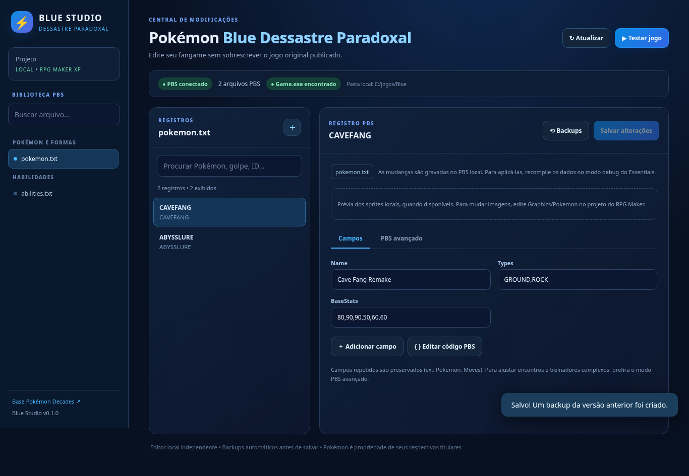

# Pokémon Blue: Dessastre Paradoxal

> Fangame **em planejamento**, derivado para uso local de **Pokémon Decades** (HazyCrazy), feito com RPG Maker XP e Pokémon Essentials v21.1. Este repositório contém o **Blue Studio**, o editor próprio. **A ROM/arquivos do jogo original não estão neste repositório**; o desenvolvimento do fangame ainda não substituiu os mapas, a história ou os assets do Decades.

**[⬇ Baixar Pokémon Blue — instalador e modificações (ZIP)](https://github.com/GabrielChavesAlencar/Pokemon-Blue-Dessastre-Paradoxal/archive/refs/heads/main.zip)** · **[Passo a passo de instalação no Windows](docs/INSTALACAO.md)**

**[⚔️ Baixar somente o Hub de Batalha](https://github.com/GabrielChavesAlencar/Pokemon-Blue-Dessastre-Paradoxal/releases/latest/download/Blue-Battle-Hub.zip)** · **[Montador nativo, PokéPaste e instalação do Hub](docs/HUB_BATALHA.md)**

Extraia o ZIP, instale Python e Git e abra **`INSTALAR_JOGO.bat`**. Depois, use **`ABRIR_JOGO.bat`** para a campanha. O instalador baixa a base separadamente e aplica as modificações; o ZIP funciona sem uma pasta `.git`. Enquanto o repositório for privado, o download exige acesso autorizado no GitHub. A publicação para todos estará disponível quando o autor tornar o repositório público.



*Prévia com dados demonstrativos: o jogo original não faz parte do download.*


## Restauracao de Pokemon e golpes da geracao 9

A base local foi restaurada e recompilada com as referencias do Essentials 21.1 e do Generation 9 Pack 3.3.3, preservando campanha e recursos. [Relatorio e limites](docs/RESTAURACAO_GERACAO9.md).

Para reproduzir a restauracao em outra copia local do Decades, execute `python scripts/official_rules/restore.py` para preparar e validar; use `--apply` para aplicar com backup. [Instrucoes](docs/REAPLICAR_REGRAS_OFICIAIS.md). O procedimento baixa referencias verificadas por SHA-256 e mantem os arquivos do jogo fora do Git.

O editor aceita golpes de evolucao no nivel **0**, alem dos niveis 1–100, e comentarios numericos dos PBS do Decades. O `RUN.bat` permanece em uma unica pasta mesmo se a atualizacao falhar.

## Geração especial: Dessastre Paradoxal

**59 espécies autorais e 12 Mega Evoluções**, com sprites, tipos, habilidades e learnsets conciliados da Fan Dex e do documento mestre do autor. No portal, use o filtro **Dessastre Paradoxal**. As descrições começam em `????`; sete espécies ainda sem atributos ficam identificadas como pendentes e fora das batalhas.

Na base local, 52 espécies e as 12 Megas estão compiladas. Use **`IMPORTAR_DESSASTRE_PARADOXAL.bat`** para reproduzir a importação e **`TESTAR_BATALHA.bat`** para testar. Mega Sol também foi implementada. [Manual, evoluções, fontes e critérios](docs/GERACAO_DESSASTRE_PARADOXAL.md).

## Testar batalhas sem avançar na campanha

Abra **`HUB_DE_BATALHA.bat`** (ou o atalho compatível `TESTAR_BATALHA.bat`) para o **Hub de Batalha**: montador dentro da janela do jogo, importação de PokéPaste/Showdown para os dois lados, biblioteca de times, busca, EVs/IVs/Nature e lutas individuais ou duplas. A sessão não carrega nem salva a campanha. O botão **MULTIPLAYER** cria ou entra em uma sala para lutar contra outro jogador: [como jogar](docs/MULTIPLAYER.md). A barra de HP tem descida e recuperação graduais. [Manual do Hub](docs/HUB_BATALHA.md) · [Notas do laboratório original](docs/LABORATORIO_BATALHA.md). Para abrir o portal local, execute **`ABRIR_SITE.bat`** e visite `http://127.0.0.1:4173`.

A **IA Blue Radical** adapta princípios públicos do CFRU e do estudo do autor à engine instalada: dano, prioridade, trocas, hazards, suporte e duplas. O laboratório permite compará-la à IA original da base. Execute **`APLICAR_IA_RADICAL.bat`** para instalar em outra cópia da mesma base. [Perfis, fontes, logs e testes](docs/IA_BLUE_RADICAL.md).

**Músicas aleatórias por batalha:** listas separadas para treinadores, encontros selvagens e líderes/Mestres de Tipo, com uma escolha por luta e sem repetir imediatamente a última faixa. A coleção local tem 7/6/6 músicas; o Blue Studio permite editar cada lista. [Importação, controles e testes](docs/EDITOR_MUSICAS.md).

**Campanha Traditional Starters:** progressão Inicial (0–1 esmeralda, BST até 350), Intermediária (2–3, até 450) e Avançada (4+, equipes originais), com revanches por estágio sem repetir drops. Entradas de batalha inspiradas no FireRed, EXP suave e mouse nos menus da campanha. [Regras, controles e validação](docs/PROGRESSAO_E_ANIMACOES.md).

## Pacote de músicas de Kanto

O [inventário das 64 faixas de Kanto e instruções de publicação](docs/KANTO_MUSICAS_PACOTE.md) contém checksum do ZIP recebido, validação de formato e o atalho `SUBIR_MUSICAS_KANTO.bat`. O repositório é **público**; arquivos originais de trilha sonora só devem ser disponibilizados se houver autorização para redistribuí-los. **O ZIP não foi enviado automaticamente por esta alteração.** Para adicionar músicas à cópia local do jogo sem distribuí-las, use o [editor de músicas](docs/EDITOR_MUSICAS.md).

## Diálogos FireRed e tradução de Kanto

O projeto possui um [guia de catálogo e tradução dos diálogos FireRed](docs/Guia_Dialogos_Pokemon_FireRed_EN_PT.md), o [passo a passo de adaptação para o Dessastre Paradoxal](docs/FIRERED_DIALOGOS_PASSO_A_PASSO.md) e um [extrator local EN/PT-BR](scripts/localization/extrair_traduzir_dialogos_firered.py). O extrator funciona sobre uma fonte de referência local e não inclui o roteiro original. **Esta documentação não instala diálogos nem altera eventos**; novas cenas exigem autorização e testes no piloto isolado de Kanto.

## Continuidade do projeto

[Próximos passos do jogo, de Kanto e do portal](docs/PROXIMOS_PASSOS.md) · [Plano Codex de testes reais para a Barra 2](docs/KANTO_CODEX_TESTES_E2E.md) · [Prompt pronto para Codex](docs/KANTO_CODEX_PROMPT.md)

## Portal do projeto

O site fica em **`site/`** no mesmo repositório: Pokédex, formas, golpes, localizações, guias e diário automático de commits. [Executar o site](site/README.md) · [Deploy na Vercel e rotina de atualizações](docs/SITE_E_VERCEL.md).

## Interface inspirada no editor de ROM do Emerald Studio (v0.2)

A navegação do **Blue Studio** foi reorganizada com o mesmo conjunto de **14 abas principais + 6 ferramentas avançadas** do editor de ROM do [Emerald Studio](https://github.com/Lancelioti/emerald-studio). O tema foi adaptado para **Pokémon Essentials / RPG Maker XP**.

- **Áreas superiores:** Visão geral, Editor de ROM e Ver MD de Movesets.
- **Funcionais hoje:** Pokédex (`pokemon.txt`), Itens (`items.txt`), Treinadores (`trainers_story_mode.txt`) e Selvagens (`encounters.txt`) usam o editor PBS real. **Músicas** oferece biblioteca com prévia, importação/substituição e escolhas para batalhas e cidades/mapas: [manual](docs/EDITOR_MUSICAS.md).
- **Planejadas:** Projeto, História e eventos, Flags, Iniciais, Mapas, Logo inicial, Fundo animado, Estúdio MIDI, Test Lab e as 6 avançadas. Os painéis identificam claramente o que falta, sem salvar dados falsos.
- **Testes contínuos:** `.github/workflows/regression.yml` roda testes Python de PBS/API e contratos UI, valida JS e testa a navegação/salvamento real no Chromium (Playwright) em cada push para main e a cada PR, quando GitHub Actions está habilitado.
- **Testes locais:** execute `TESTAR.bat`. Os testes Python não precisam do jogo; o teste Chromium é executado no CI.
- **Plano:** [docs/PLANO_EDITOR_EMERALD_BLUE.md](docs/PLANO_EDITOR_EMERALD_BLUE.md).

A equivalência atual é **visual e de navegação**. Não utiliza offsets de ROM GBA, BPS ou sprites 4bpp; novos módulos serão construídos sobre arquivos PBS, plugins e dados RXDATA do Essentials.

## Sprites estáticos e animados (Pokédex)

**Battle Mode e desempenho:** Poké Bola geradora da geração Dessastre Paradoxal, controles separados de Terastal/Dynamax/Mega/Z-Moves e qualidade Original/Leve/Econômica dos sprites. Disponíveis no jogo e no laboratório: [manual](docs/BATTLE_MODE_E_DESEMPENHO.md).

A Pokédex do Blue Studio possui **quatro campos de imagem** por Pokémon: frente, costas, frente shiny e costas shiny. Cada imagem pode ser **PNG estático** (um quadro) ou **animação GIF/PNG spritesheet**. Isso evita exigir GIF para Fakémon estáticos.

Ao escolher um registro em `pokemon.txt` ou `pokemon_forms.txt`, use **Importar imagem** em cada variante. O servidor valida tipo e tamanho, cria backup e grava diretamente na pasta local `game/Graphics/Pokemon/`. PNG em faixa é tratado como animado pelo plugin do Decades quando sua largura ultrapassa duas vezes a altura. Formas `[CHARIZARD,1]` usam `CHARIZARD_1.png`.

**Limite atual:** 5 MB por imagem; backups em `.blue-backups/sprites/`. Não são publicados no GitHub, pois o jogo original está ignorado em `.gitignore`. O carregamento in-game em Windows ainda exige teste integrado. O editor **não é 100% funcional**: não compila PBS automaticamente nem oferece edição de pivot e métricas de batalha.

Confira a [auditoria técnica e próximos passos](docs/AUDITORIA_EDITOR_POKEMON.md).

## Aba exclusiva: ⚔️ Golpes dos Pokémon (v0.4)

No menu **Editor de ROM**, a aba **Golpes dos Pokémon** permite selecionar qualquer espécie ou forma cadastrada no Decades — inclusive seus novos Fakémon — e editar **`Moves` (nível), `TutorMoves` (tutor/TM) e `EggMoves` (ovo)**. Há pesquisa, sugestão de IDs e nomes, herança de movesets para formas alternativas, adição e remoção de linhas e salvamento exclusivo dos campos de golpes.

A gravação valida os golpes contra o catálogo `moves*.txt`, cria backup e preserva os outros campos da espécie. A compilação dentro do Pokémon Essentials ainda precisa ser feita pelo modo Debug.

**[Manual da aba de golpes](docs/EDITOR_GOLPES_POKEMON.md)**.

## Adicionar Pokémon novos sem substituir nenhum (v0.3)

O Blue Studio **não utiliza slots ou IDs numéricos fixos do GBA**. As espécies novas têm identificadores simbólicos exclusivos, como `CAVEFANG` ou `ABYSSMON`, e são acrescentadas a `PBS/pokemon.txt`, com entrada própria em `PBS/pokemon_metrics.txt`. O cadastro confere duplicidade nos arquivos `pokemon*.txt` do Decades, incluindo outros pacotes de gerações, e preserva os registros anteriores.

**Fluxo de uso:** rode `RUN.bat` → **Editor de ROM → Pokédex** → **＋ Adicionar Pokémon**. Preencha ID, nome, tipo(s), habilidades, golpes e atributos; clique **Criar nova espécie sem substituir**. A tela abrirá o novo registro, com **Ficha Pokémon** (edição de campos e validação de referências), editor de sprites normal/shiny e ajustes reais de posição/escala em batalha (PBS Metrics). Antes de salvar alterações na ficha, clique **Validar dados**; depois clique **Salvar alterações**. As métricas possuem botão **Salvar posição/escala no jogo** separado.

**Compilação para o jogo:** depois de modificar os PBS, clique **Abrir Debug / Compilar PBS**. O Blue Studio tenta iniciar o atalho oficial `Game.exe - Debug Mode.lnk` do Decades. No jogo, use **Debug → Files → Compile data**, ou o procedimento de compilação do Pokémon Essentials 21.1. A interface mostra uma checagem de timestamps de `Data/species.dat` e `Data/species_metrics.dat`, **mas isso não prova que a compilação foi concluída**. A confirmação real precisa vir do runtime do Essentials. O editor não tenta executar um compilador de ROM GBA em um jogo RPG Maker XP.

**Limitações atuais:** espécies recém-criadas precisam ser incluídas nos encontros/treinadores e, se desejado, nas Pokédex regionais; a compatibilidade final de GIF e animações dentro de uma batalha deve ser testada no Windows. O teste automatizado roda com dados sintéticos e não modifica os arquivos do jogo real.

Detalhes e pendências: [auditoria técnica](docs/AUDITORIA_EDITOR_POKEMON.md).

## O que já funciona

- **Blue Studio** no navegador, com Python 3 e sem dependências externas.
- Identificação de arquivos `.txt` de `game/PBS/`, inclusive os pacotes personalizados do Decades.
- Busca de Pokémon, formas, habilidades, golpes, itens, encontros e treinadores por ID/nome.
- Formulário de edição de campos PBS e editor avançado do texto original (incluindo campos repetidos).
- Inclusão de novos registros com modelos básicos editáveis.
- Salvamento diretamente nos arquivos locais do projeto; não mexe no repositório do Decades original.
- Backups automáticos na pasta `.blue-backups/`, com histórico de até 20 cópias por arquivo e restauração.
- Detecção de alterações simultâneas (hash SHA-256) para evitar sobrescrever edição de outra ferramenta.
- Prévia de sprites front/back quando presentes nos caminhos padrão do Essentials.
- Botão **Testar jogo**, que executa `game/Game.exe` no Windows.

**Ainda não disponível:** edição visual dos mapas, importação/conversão de sprite sheet 64×64, compilação automática dos PBS no jogo, gerenciamento visual complexo de encontros e equipes, sprites editor, criação automática da campanha, sistema de Paradoxos ou novas Mega Evoluções. Para essas tarefas ainda é necessário usar o RPG Maker XP e/ou desenvolver novos scripts/plugins.

## Requisitos no Windows

- Windows 10/11 e **Python 3.10+** instalado (`py` ou `python` no PATH).
- **Git** para baixar a base original.
- **RPG Maker XP** para editar mapas, eventos e scripts da engine (software comercial).
- **GitHub CLI (`gh`)** se quiser publicar este editor em um novo repositório da sua conta pelo script fornecido.
- Espaço em disco e internet suficientes: o repositório do Decades tem perto de 936 MiB de tamanho reportado pelo GitHub, podendo exigir mais espaço durante download e uso.

## Primeira execução

1. Extraia o ZIP em uma pasta, por exemplo `C:\Projetos\Pokemon-Blue-Dessastre-Paradoxal`.
2. Execute **`BAIXAR_BASE_DECADES.bat`** para baixar o Decades para `game/` (cópia local, ignorada pelo Git).
3. O instalador ajusta o título da janela do jogo para **Pokémon Blue: Dessastre Paradoxal** (arquivos locais `Game.ini` e `mkxp.json`); execute **`RUN.bat`**. O navegador abrirá o endereço `http://127.0.0.1:8765`.
4. Escolha `pokemon.txt` para editar espécies; `pokemon_forms.txt` para formas; `trainers_story_mode.txt` para treinadores; `encounters.txt` para encontros.
5. Clique em um registro, modifique e salve. É criado um backup local antes de escrever.
6. Para o jogo aplicar dados PBS alterados, abra o projeto em modo **debug** pelo RPG Maker XP ou pelo procedimento de compilação do Pokémon Essentials v21.1. O botão **Testar jogo** só inicia o executável: **não recompila o PBS automaticamente**.

Se você já baixou Pokémon Decades, copie os arquivos para `game/` mantendo `Game.exe`, `Game.rxproj`, `Data/`, `PBS/`, `Graphics/` e `Plugins/`, sem precisar baixar novamente.

> Alternativa: definir a variável de ambiente `BLUE_GAME_DIR` com o caminho da sua cópia local do jogo e executar `RUN.bat`. Arquivos originais não precisam ficar dentro desta pasta.

## Abrir e atualizar automaticamente (RUN.bat)

O **RUN.bat** agora verifica o GitHub e tenta atualizar o editor pela branch `main` antes de abrir o Blue Studio no navegador. **Nao exige GitHub CLI (`gh`)**: basta **Git for Windows** com acesso a este repositorio privado e **Python 3.10+**.

- **Pasta clonada por Git:** clique duas vezes em `RUN.bat`. Ele executa `git pull --ff-only origin main`, depois inicia o servidor Python em `http://127.0.0.1:8765` (o navegador abre automaticamente).
- **Pasta extraida de ZIP (sem `.git`):** o editor abre nesta mesma pasta. A atualizacao Git e ignorada; nenhuma pasta duplicada e criada.
- **Sem Git, sem acesso a rede ou com conflito:** o editor local ainda pode abrir, mas a atualizacao sera pulada e aparecerá um aviso. Para projeto privado, o Git pode solicitar autenticacao no navegador por meio do Git Credential Manager.
- **Alteracoes locais:** a atualizacao nao usa `git reset --hard`, `git clean` ou `--force`. Se um arquivo modificado impedir o pull, corrija o conflito manualmente; **nao** sera apagado.
- **Jogo e dados locais:** `game/` e `.blue-backups/` sao ignorados pelo Git e nao recebem atualizacoes do Decades automaticamente. O script atualiza **o codigo deste repositorio**, nao os arquivos da base original.

Se o script antigo ainda estiver no computador, voce pode atualizar uma vez pelo terminal, dentro de uma pasta clonada:

```powershell
git pull --ff-only origin main
```

Se nao tiver clone e quiser criar um manualmente (requer autorizacao no repositorio privado):

```powershell
git clone https://github.com/GabrielChavesAlencar/Pokemon-Blue-Dessastre-Paradoxal.git
```

Depois execute `RUN.bat` da pasta clonada.

### Se o RUN.bat disser "A branch atual nao e main"

Essa mensagem vinha da versão antiga do iniciador. **Corrigido na branch main.** O novo `RUN.bat` verifica a branch atual; se a área de trabalho estiver limpa, muda para `main` sem descartar arquivos e sincroniza a versão atual. Se houver alterações locais ou conflitos, abre a copia local e preserva o conteudo original, sem criar outra pasta. `game/` e backups não são sincronizados nem apagados.

Para quem ainda usa o `RUN.bat` antigo, a correção inicial precisa ser aplicada **uma vez**. Substitua `RUN.bat` pelo arquivo atualizado do repositorio. O iniciador migra para `main` quando possivel e abre o editor nesta mesma pasta.

CI: `.github/workflows/regression.yml` também executa um teste real do iniciador em `windows-latest`, simulando uma branch antiga, verificando `main` e repetindo o RUN em modo de teste (`BLUE_STUDIO_NO_SERVER=1`).

## Criar o repositório GitHub

Execute **`PUBLICAR_GITHUB.bat`** depois de instalar `git` e `gh` e fazer login com `gh auth login` (o script pode iniciar esse login).

O script cria `Pokemon-Blue-Dessastre-Paradoxal` **privado** na sua conta e publica apenas o editor, a documentação e os scripts originais. A pasta `game/`, os saves, backups e outros dados locais são excluídos pelo `.gitignore`.

> Não é possível criar um repositório novo usando a conexão GitHub disponível nesta conversa. O script funciona **na sua máquina autenticada**, com permissão para criar repositórios na sua própria conta.

## Estrutura

```text
Pokemon-Blue-Dessastre-Paradoxal/
├── RUN.bat                    # Sincroniza o GitHub e abre Blue Studio no navegador
├── BAIXAR_BASE_DECADES.bat    # Baixa Decades SOMENTE para uso local
├── JOGAR.bat                  # Inicia Game.exe, se instalado
├── PERSONALIZAR_JOGO.bat      # Ajusta o titulo local da janela do fangame
├── ABRIR_RPG_MAKER.bat        # Abre Game.rxproj
├── PUBLICAR_GITHUB.bat        # Cria repo privado com GitHub CLI
├── server/main.py             # Servidor HTTP local e API PBS
├── web/                       # Interface visual do Blue Studio
├── tests/                     # Testes automatizados
├── examples/                  # Modelo de espécie ORIGINAL, não aplicado
├── docs/                      # Próximas etapas e notas de distribuição
├── game/                      # Não versionada: cópia local do Decades
└── .blue-backups/             # Não versionada: histórico de alterações
```

## Testes

```powershell
py -3 -m unittest discover -s tests -v
```

Para abrir o editor manualmente:

```powershell
py -3 server\main.py --port 8765
```

## Licenciamento, créditos e distribuição

**Créditos obrigatórios:** HazyCrazy / Pokémon Decades, Pokémon Essentials e cada criador de plugins, músicas, sprites e outros recursos conforme `game/Credits.txt` e respectivas licenças. O projeto original está em <https://github.com/HazyCrazy/Pokemon-Decades>.

O repositório público original do Decades **não apresenta uma licença explícita no diretório raiz consultado em 31/10/2026**. Ser público no GitHub **não equivale a autorização ampla** para republicar ou adaptar comercialmente o conteúdo de terceiros. **Peça permissão ao autor e revise os créditos/licenças** antes de disponibilizar cópias modificadas do jogo, sprites, músicas, scripts ou qualquer distribuição pública. Os direitos da franquia Pokémon e dos personagens pertencem aos respectivos titulares. Este projeto independente não tem afiliação oficial.

O Blue Studio aqui fornecido é código original. Você pode utilizá-lo, modificá-lo e publicá-lo conforme o arquivo `LICENSE` (MIT), sem estender essa licença ao Decades ou ao Pokémon Essentials.

## Referências

- [Pokémon Decades — repositório do criador](https://github.com/HazyCrazy/Pokemon-Decades)
- [Pokémon Decades — fórum oficial do fangame](https://eeveeexpo.com/threads/9341/)
- [Pokémon Essentials Wiki](https://essentialsdocs.fandom.com/wiki/Essentials_Docs_Wiki)
- [RPG Maker XP](https://store.rpgmakerofficial.com/products/rpg-maker-xp)
