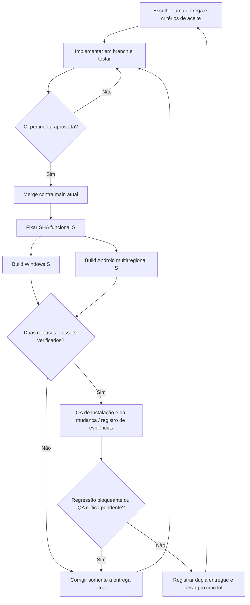

# Kanto — roadmap de conclusão e publicação sincronizada Windows/Android

**Data de referência:** 27/11/2026 (Brasília)  
**Escopo:** Kanto no jogo principal do Pokémon Blue — Dessastre Paradoxal, não um piloto separado.  
**Regra de entrega solicitada pelo proprietário:** cada mudança perceptível ao jogador deve produzir uma versão Windows e uma versão Android antes de iniciar outra funcionalidade. Não acumular várias entregas inéditas aguardando publicação.

## 1. Diagnóstico e baseline verificável

| Indicador | Baseline |
|---|---|
| Revisão funcional comum publicada | `98b07acb1f899bdfa7d541369632f1649843cd6e` |
| Main observada antes deste documento | `5cf770e331d403ec4c6b36f29d6cabba6f2fefe5` (somente histórico do site após o commit funcional) |
| Windows | [battle-hub-1589-98b07ac / Blue-Story.exe](https://github.com/GabrielChavesAlencar/Pokemon-Blue-Dessastre-Paradoxal/releases/tag/battle-hub-1589-98b07ac) |
| Android compartilhado | [android-multiregion-73-98b07ac](https://github.com/GabrielChavesAlencar/Pokemon-Blue-Dessastre-Paradoxal/releases/tag/android-multiregion-73-98b07ac) |
| CI do commit funcional | 8 workflows observados, 8 concluídos com sucesso; [Kanto](https://github.com/GabrielChavesAlencar/Pokemon-Blue-Dessastre-Paradoxal/actions/runs/45744488166), [Android integrado](https://github.com/GabrielChavesAlencar/Pokemon-Blue-Dessastre-Paradoxal/actions/runs/45744488090), [Hub/Windows](https://github.com/GabrielChavesAlencar/Pokemon-Blue-Dessastre-Paradoxal/actions/runs/45744488069) |
| Fonte auditada | Essentials FRLG 21.1 / 1.1; SHA-256 `48883c8217bcd9e7fa1b9446bddaa9db5f9715a7ba73ac02785b6660769e2683` |
| Cobertura | 145/207 mapas de conteúdo (70,05%); 110 fora da prévia, 35 em prévia, 62 ausentes |
| Barras oficiais | Engenharia 16/16; aceite integral 1/16 (6,25%); classificação `prototype` |
| QA física | Última migração Windows e instalação/jogabilidade Android pós-patch não confirmadas |

A auditoria de 19/11 encontrou 217 entradas descendentes de Kanto, das quais dez são candidatos estruturais sem conteúdo (035, 049, 073, 089, 099, 116, 130, 154, 192, 204). Não as incluir na meta de 207 mapas jogáveis. Este denominador vale para o recorte da fonte auditada, não para todas as áreas possíveis de FireRed/LeafGreen, Sevii ou expansões. Reauditar antes de alterar o denominador. Fora de preview não significa jogável integralmente.

As contagens de 109/126/142 mapas em documentos antigos são históricas. A contagem atual vem de [kanto-source.json](../data/regions/kanto-source.json) e [auditoria de mapas](KANTO_MAPAS_AUSENTES_2026_11_19.md). Não confundir o progresso de núcleos técnicos com cobertura de mapas, eventos ou gameplay. Não elevar as barras por publicação.

### 1.1 Windows: prioridade inicial K00-W

- [PR #340](https://github.com/GabrielChavesAlencar/Pokemon-Blue-Dessastre-Paradoxal/pull/340): migração 142 → 145, manutenção de IDs, alocação de três novos IDs, staging e rollback.
- [PR #341](https://github.com/GabrielChavesAlencar/Pokemon-Blue-Dessastre-Paradoxal/pull/341): recuperação de divergência no Map300.rxdata antes da gravação; só restaurar se identidade/registro de propriedade e origem comprovarem o mapa correto. Rejeitar mapas estrangeiros, arte alterada e conflito de IDs.
- Validar instalação limpa e migração 142 → 145 em cópias independentes. Incluir mapa antigo ausente, checksum divergente reconhecido, arquivo estrangeiro, falta de espaço/interrupção, segunda execução idempotente, rollback integral e abertura/recompilação do Game.exe.
- Confirmar no aparelho do usuário: o instalador não fica travado, 145 mapas registrados e presentes, jogo abre no mesmo perfil, Novo Jogo/Continuar funcionam. Não apagar pasta game, marcadores, MapInfos ou saves para contornar falhas.
- Build 1589 é um inicializador autoatualizável; o EXE sozinho não contém o jogo completo. Registrar também o SHA efetivamente sincronizado e compilado na instalação, que pode avançar quando o launcher baixa a main.

### 1.2 Android: prioridade inicial K00-A

- [PR #252](https://github.com/GabrielChavesAlencar/Pokemon-Blue-Dessastre-Paradoxal/pull/252) acrescentou Route24 (fonte 053), Route25 (054), Bill (055) e Gary, Nugget Bridge e ticket; [#259](https://github.com/GabrielChavesAlencar/Pokemon-Blue-Dessastre-Paradoxal/pull/259) corrigiu o nome de Luis alterado por Journey para o treinador Full Power de Decades. Preservar BLUE_KANTO_*.
- [#268](https://github.com/GabrielChavesAlencar/Pokemon-Blue-Dessastre-Paradoxal/pull/268) corrigiu a paginação das releases multirregionais. Build 73: ZIP, manifesto, SHA-256 e oito arquivos incrementais publicados (incluindo alias; não afirmar oito baselines distintas).
- O pacote correto para Kanto no mundo compartilhado é Blue-Android-Decades-Kanto-Hoenn.zip e seu manifesto. Blue-Android-JoiPlay.zip da release Hub e o piloto isolado kanto-android-* não são substitutos. Não misturar canais ou perfis.
- Com JoiPlay fechado, na pasta exata usada pelo jogo, executar `python ATUALIZAR-ANDROID.py` para diagnóstico e depois `python ATUALIZAR-ANDROID.py --update`. Conferir Data/blue-update.json (canal e revisão), menu de versão, MapIDs instalados e cache compilado; sem editar marcador. Se não houver delta compatível, corrigir a seleção/publicação de baselines ou construir uma cadeia verificada; não forçar patch de outro canal nem baixar o ZIP completo automaticamente. O usuário prefere somente arquivos alterados, sem backup completo automático. Fallback integral apenas com consentimento explícito.
- Testar em JoiPlay: Cerulean ↔ Route24 ↔ Route25 ↔ Bill (ida e volta física), Gary conforme inicial, Luis/Diana/Misty, derrota/repetição/vitória e save/reload. A [issue #250](https://github.com/GabrielChavesAlencar/Pokemon-Blue-Dessastre-Paradoxal/issues/250) segue aberta até evidência pós-patch. Não inferir versão do aparelho de uma captura isolada.
- Verificar fontes/hashes e direitos de uso antes da distribuição; não espelhar arquivo FRLG completo, ROMs, engine, assets de terceiros sem autorização, nem publicar saves.

## 2. Contrato obrigatório: uma mudança perceptível = uma dupla de versões

Mudança perceptível inclui nova cidade/rota/interior, NPC, batalha, item/quest, desbloqueio, alteração visual/áudio/diálogo, correção de bug, mudança de balanceamento, viagem, menu, progresso, save ou instalador/atualizador. Entregar uma unidade vertical pequena que funcione; não publicar só um pedaço quebrado de uma história. Uma entrega pode reunir arquivos e testes inseparáveis para o mesmo resultado; não reunir funcionalidades independentes. Documentação pura, relatórios e refatorações sem efeito no jogador não exigem nova dupla de versões, embora workflows atuais possam disparar automaticamente. Se houver dúvida se a alteração é perceptível, tratar como perceptível.

### 2.1 Máquina de estados



1. Conferir main, releases e issue do lote anterior. Se a dupla ainda não existir ou estiver divergente, **não começar conteúdo novo**.
2. Selecionar uma unidade visível, listar mapa/evento afetado, dependências, como reproduzir, regressões esperadas e critérios de aceite nas duas plataformas. Manter uma única entrega ativa de Kanto. Se uma fase contém múltiplas entregas perceptíveis, repetir todo o ciclo por sublote.
3. Criar branch/PR baseado na main atual. Implementar código, dados, testes e atualização de manifesto pertinentes; preservar trabalho de outras regiões. Não alterar saves pessoais. Revisar diff e executar verificações locais e CI obrigatórias/pertinentes na HEAD exata contra a base atual; falha, cancelamento, skip obrigatório ou ausência de evidência não é aprovação. Rebase/merge da base exige revalidar.
4. Merge somente aprovado. Fixar o SHA funcional S na main. Não confundir commit de histórico gerado automaticamente com mudança do jogo. Se outro commit funcional entrar antes de publicar as duas versões, revalidar o novo SHA e construir ambas de novo ou publicar ambas do S com procedimento autorizado. Não misturar revisões.
5. Publicar Windows e Android compartilhado a partir de S; builds podem rodar simultaneamente, mas nenhuma nova feature antes de ambas finalizarem. Usar os workflows existentes, inclusive dispatch explícito quando os filtros de paths não acionarem o workflow. Não inventar execução se o cliente não puder dispará-la. Aguardar resultado real em GitHub; em sessões sem execução contínua, registrar o estado e retomar somente após verificar.
6. Validar releases/arquivos e instalação. Se uma build falhar ou só uma plataforma tiver sido publicada, estado `BLOCKED_RELEASE`. Corrigir causa no mesmo lote, executar regressão e publicar novo par de revisão comum. Não avançar por build verde sem asset publicado.
7. Executar smoke da mudança em ambos os ambientes disponíveis. Se encontrar regressão que bloqueie instalação, saves, campanha, paridade ou segurança, congelar avanço e corrigir/publicar o par. Sem acesso ao ambiente, usar `BLOCKED_ENV` para QA física, nunca PASS. Para K00 e gates críticos (migração, save, viagem, nova progressão obrigatória), exigir evidência real nas duas plataformas antes de desbloquear a fase seguinte. Para mudanças não críticas já publicadas e validadas estruturalmente, o próximo lote pode ser liberado apenas após registrar a QA física pendente, instruções de teste e ausência de regressão conhecida; aceite integral continua bloqueado. O proprietário pode optar por aguardar o teste físico de cada entrega.
8. Atualizar issue/manifesto/portal e histórico da entrega com links, revisão e matriz de testes. Registrar o próximo lote somente após cumprimento do gate. Não aumentar Barra 2 por CI, compilação ou publicação.

### 2.2 Publicação: workflows e evidências obrigatórias

| Plataforma | Workflow | Arquivos que devem existir na release |
|---|---|---|
| Windows | [battle-hub-release.yml](../.github/workflows/battle-hub-release.yml) (release versionada battle-hub-N-SHA); [blue-story-windows.yml](../.github/workflows/blue-story-windows.yml) (canal independente quando aplicável) | Blue-Story.exe com estado uploaded; registrar link versionado, tamanho e SHA-256 medido do asset; se houver canal estável adicional, conferir que aponta para a mesma build funcional antes de recomendá-lo |
| Android integrado | [android-multiregion.yml](../.github/workflows/android-multiregion.yml) | Blue-Android-Decades-Kanto-Hoenn.zip, .zip.sha256, .update.json, patches por baseline e alias quando aplicável; estado uploaded, hashes e revisão corretos |

Os filtros atuais de Android não abrangem automaticamente todo arquivo capaz de afetar gameplay (por exemplo, catálogo/dados, músicas e alguns plugins). Em cada lote, conferir os workflows disparados e solicitar dispatch dos faltantes. **Não confundir a release latest do Hub com a release multirregional Android.** O pipeline Hub compila a base usando --skip-kanto; portanto prova do EXE Windows não substitui a verificação de Kanto instalada no jogo principal. O workflow dedicado Windows também não é prova de gameplay. O Android compila e empacota conteúdo integrado; a compilação nativa em runner Windows não é execução no JoiPlay.

Revisão funcional comum significa paridade dos scripts e conteúdo Kanto, exceto adaptações legítimas de plataforma (controles, launcher, performance, áudio/renderização mobile). Verificar a revisão do pacote e a realmente instalada. Guardar versão legível com data/hora e SHA curto no menu do jogo; se algum caminho ainda não exibir os dados corretamente, corrigir como entrega perceptível própria.

Gates técnicos: verificar [verify_pilot.py](../scripts/regions/verify_pilot.py), [verify_kanto_cerulean.py](../scripts/android/verify_kanto_cerulean.py), [publish_updates.py](../scripts/android/publish_updates.py) e [update_client.py](../scripts/android/update_client.py). Quando ampliar mapas, atualizar os verificadores/gates de 145 para a contagem efetiva derivada do manifesto, sem relaxar cobertura ou a regressão dos 145 anteriores. Validar lista completa de mapas, dimensões, eventos e conexões remapeadas, PBS, plugin compilado, dependências, áudio e manifesto. Não mascarar exit codes. Preservar patch da última release publicada e testar baselines antigas ainda utilizadas pelo jogador; não declarar compatibilidade só por existir um patch genérico. Não cancelar uma publicação em andamento com um lote novo.

### 2.3 Modelo de registro por entrega

```yaml
entrega: K00-W
descricao_perceptivel: ""
pr: null
base_sha: null
head_sha: null
merge_sha_funcional: null
ci: {workflows_aprovados: null, jobs_aprovados: null, urls: []}
windows: {tag: null, exe_url: null, sha256: null, revisao_instalada: null, qa: PENDING}
android: {tag: null, zip_url: null, manifesto_url: null, sha256: null, patches_baseline: [], revisao_instalada: null, qa: PENDING}
conteudo: {catalogo: 145, previews: 35, ausentes: 62}
teste_mudanca: {windows: PENDING, android: PENDING, evidencias: []}
regressao: PENDING
barra_2: 1/16
status: PENDING
proximo_lote_liberado: false
bloqueios: []
```

Estados: PENDING, IN_PROGRESS, CI_PASS, MERGED, BLOCKED_RELEASE, PUBLISHED_BOTH, BLOCKED_ENV, QA_FAIL, QA_PASS, DELIVERED_WITH_QA_PENDING, ACCEPTED. Somente preencher com dados verificados; não usar o exemplo como recibo. Se uma build falhar depois de publicada a outra, manter as tags antigas rastreáveis e registrar novo par corrigido; não apagar releases de usuários para simular sincronia.

## 3. Inventário histórico de mapas ausentes (62 na baseline de 145)

IDs abaixo são **IDs da fonte FRLG**, não IDs de destino no Blue nem coordenadas de teleporte. O importador deve preservar a ordem estável dos IDs existentes, verificar MapInfos/Data/PBS de todas as regiões, alocar somente IDs livres, persistir mapa fonte→destino, rever dependências de tilesets/gráficos e manter saves. Não importar switches/scripts estrangeiros cegamente.

| Lote de mapas | IDs fonte | Qtde | Entrega/necessidades |
|---|---|---:|---|
| Diglett's Cave | 023, 081, 082 | 3 | duas entradas e túnel, Rota2↔Rota11, encontros e acesso físico |
| Cerulean/creche | 043–048, 058 | 7 | Bike Shop, casas, casa roubada, Day Care; voucher/quest e portas; creche sem duplicação de Pokémon |
| Cerulean Cave | 050–052 | 3 | três andares, gate pós-Liga conforme regras Blue, Mewtwo especial |
| Vermilion | 068–071 | 4 | Fan Club, casas, pescador; voucher/vara se confirmados pela fonte |
| Rota11 | 079–080 | 2 | mapa, portaria e conexões/treinadores |
| Rota12 | 083–085 | 3 | portaria, pescador e bloqueio Snorlax |
| Rock Tunnel | 086–088, 090–091 | 5 | rotas9/10, Centro Pokémon e dois andares; Flash e saída física |
| Power Plant | 092 | 1 | acesso, encontros, itens, Zapdos |
| Lavender/Pokémon Tower | 093–098, 100–106 | 13 | cidade, serviços e casas; sete andares com Marowak, Rocket, Mr. Fuji e Poké Flute |
| Celadon/Rocket | 125–129, 131–135 | 10 | interiores, Game Corner, quatro subsolos e elevador; Lift Key/Silph Scope |
| Rotas16/17 | 136–140 | 5 | portaria, Secret House, variantes da Rota16, Cycling Road; bicicleta/Snorlax |
| Fuchsia | 148–151 | 4 | casas e pescador; portas, itens/varas se confirmados |
| Rotas13/14 | 166–167 | 2 | conexão do corredor oriental e treinadores |
| **Total** | | **62** | |

Não importar entradas de hierarquia 035/049/073/089/099/116/130/154/192/204 como conteúdo novo. Reexecutar `python scripts/regions/audit_kanto_coverage.py` após cada lote, com fonte preparada por SHA; comparar contagens e destinos ausentes sem confundir referências de portas bloqueadas intencionalmente com caminhos disponíveis.

## 4. Converter 35 previews em conteúdo funcional

| Grupo | IDs fonte | Qtde | Aceite específico |
|---|---|---:|---|
| Saffron/portarias/passagens | 057, 062, 107–113 | 9 | rotas7/8, portarias norte/sul/leste/oeste e passagens, guardas com pré-requisitos comprovados |
| Celadon Dept. Store | 117–123 | 7 | seis pisos/terraço conforme fonte e elevador; lojas, portas/escadas e inventário |
| Fuchsia/corredor ciclável | 141–143, 164–165 | 5 | Rota18, Rota15, portarias, bicicleta, retorno e treinadores |
| Saffron/edifícios | 173–177 | 5 | Fan Club, casas A–C, lobby Silph, portas e gatilho de história |
| Litoral/Seafoam | 190–191, 193–198 | 8 | rotas19/20/21 e cinco andares Seafoam; Surf, Strength, correntes e Articuno |
| Victory Road | 210 | 1 | hub: confirmar função geométrica original, passabilidade e conexões; não inventar eventos se a fonte não os tiver |
| **Total** | | **35** | |

Para cada preview, identificar eventos originais, dependências, conexões e progressão. Só retirar a marca preview após instalar/testar o comportamento pertinente (inclusive mapa puramente conectivo comprovado). Não adicionar NPC/evento fictício apenas para elevar contagem.

## 5. Roadmap sequencial de entregas jogáveis

Cada linha abaixo é uma macrofase, **não autorização para agrupar tudo numa release**. Os sublotes separados por ponto e vírgula representam entregas perceptíveis independentes e exigem a dupla Windows/Android antes do sublote seguinte. Priorizar o caminho jogável, sem abrir atalhos artificiais; uma dependência pode ser instalada inativa até seu arco de história, explicitando que não está jogável. Se a fonte contradisser a ordem, documentar ajuste antes da implementação.

| Fase | Sublotes e trabalho | Critério de aceite |
|---|---|---|
| K00 — estabilizar distribuição | K00-W: migração e inicialização Windows; K00-A: atualização Android e identificação da revisão; K00-C: regressão de Cerulean nas duas plataformas | 145 mapas preservados, atualização sem perda de saves, mesmo conteúdo, issue #250 com evidências; não iniciar K01 com bloqueio crítico |
| K01 — Pallet/primeira insígnia | seleção região/personagem/inicial e bloqueio grama; Oak/Parcel/Pokédex/Mart; portas de Pallet/Viridian/Rota2; Forest/Pewter/Brock e tênis | inicial único, avanço só após requisitos, batalha real, Boulder única, blackout regional, guardar/reabrir |
| K02 — Mt. Moon/Cerulean | Rota3 e acessos; três andares Mt. Moon, escolha exclusiva de Dome/Helix e Rocket conforme fonte; Rota4, música/escala; casas Cerulean/loja de bicicletas; Gary/Rotas24–25/Bill; Misty | escolher um fóssil, persistência, PC Bill/ticket único, Luis e Diana sem exceção, Cascade única, retorno físico |
| K03 — Vermilion/S.S. Anne | Rota5/6 e creche; Fan Club/voucher/pescador e casas; navio e rival/capitão/Cut; Lt. Surge e puzzle; Rota11 e Diglett's Cave | S.S. Ticket real, navio não pula Bill, Cut com HM/badge/Pokémon compatível, Thunder única, túnel ida/volta |
| K04 — Rock Tunnel | Rotas9/10 e Centro; dois andares/caminho com Flash; treinadores, encontros e acesso a Lavender | caminhada natural sem teleporte, Flash com Boulder e pré-requisitos regionais conforme regra vigente; verificar escuridão, retorno e derrota |
| K05 — Lavender (primeira visita) | cidade e serviços; Pokémon Tower sete andares, rival/treinadores, fantasmas e bloqueio sem Silph Scope | explorar até o bloqueio autoral legítimo, não permitir finalizar Marowak antes do item; dependência Rocket definida |
| K06 — Celadon/Rocket | Rota8, túnel/Rota7 e portarias; loja de departamentos/interiores; Erika/Cut; Game Corner/entrada secreta; Rocket Hideout andares, Lift Key e elevador; Giovanni/Silph Scope | mapa conectado, itens únicos, sem bypass de dependências, Rainbow única; Silph Scope somente com vitória/evento comprovado |
| K07 — Lavender (conclusão) | voltar com Silph Scope; Marowak e resgate de Mr. Fuji, Poké Flute; Snorlax e Rota12; Rotas13/14/15 | bloquear evento sem item, liberar física e persistentemente após evento legítimo; testar captura/derrota/fuga, Poké Flute e save |
| K08 — Cycling Road/Fuchsia | Rotas16/17/18, bicicleta e gate; casas Fuchsia/pescador; Safari ingresso/tempo ou passos/Safari Balls/encontros; Gold Teeth/Warden/Strength e Secret House/Surf; Koga | dois corredores físicos, Safari completa sem duplicação de prêmios; Soul única, HMs locais e sem softlocks |
| K09 — Saffron/Silph | portarias e requisitos de acesso; casas/Fan Club/Dojo; Silph lobby, escadas/elevador/11 andares/Card Key; rival/Giovanni/presidente; Sabrina/30 teleportes | progresso canônico, portas, Rocket e recompensa de presidente conforme fonte, Marsh única e retorno |
| K10 — mar e Cinnabar | rotas19/20/21 e Surf; Seafoam cinco andares, correntes e Strength; Articuno se permitido; laboratório e reviver fósseis; Mansion/Secret Key; Blaine/quizzes | percurso de ida/volta, fósseis persistentes sem duplicação, bloqueios de HMs, Volcano única |
| K11 — Viridian e Liga | Giovanni e gate de sete badges/Silph; rival Rota22 e Rota23; hub e três andares Victory Road; Elite Four; Blue campeão e Hall of Fame | oito insígnias de Kanto, quatro Elite + campeão em sequência sem simular vitória, derrota/retry, Hall of Fame e conquistas únicas |
| K12 — especiais/pós-jogo | Power Plant/Zapdos; Cerulean Cave/Mewtwo; outros encontros especiais autorizados; avaliar Sevii separadamente | requisitos do projeto, bloqueios de especiais, sem itens duplicados; não prometer Sevii no escopo de 207 |
| K13 — sistemas e polimento | tradução por evento e revisão EN/PT-BR; áudio por mapa/ME; sprites/escala/bordas; Trainer Card, badges e versionamento; treinadores/encontros faltantes | auditoria cruzada de todo catálogo, nenhum mapa incompleto marcado completo, regressão visual e de combate |
| K14 — campanha integral | playthrough do início à Liga Windows e Android; novo jogo e save legado; ida/volta regional; publicação final da mesma revisão | T3/T4 reais, todas as 16 etapas aceitas com evidências, nenhum bloqueio P0/P1, permissões verificadas |

Não adiar bug crítico de uma área já publicada para K13. Fósseis, Safari, diálogos, sprites e música devem ser resolvidos também no lote da área correspondente. K13 fecha cobertura residual, não substitui os critérios de cada fase. Confirmar a situação real de cada função antes de reimplementá-la: há núcleos de Silph, Sabrina, Mansion, Giovanni e Liga já aprovados em CI, e há correções posteriores de áudio, Trainer Card e bloqueios regionais. Preservar esses avanços.

## 6. Critérios transversais por entrega

- **Mapas e conexão física:** usar dimensões/eventos/tilesets da fonte auditada, remapeamento estável, portas com ida/volta, passabilidade, colisões, limites, água e terreno, bloqueios autorais. Teleporte QA só posiciona teste, nunca comprova caminho natural. Sem placeholders vazios. Não alterar MapIDs antigos.
- **Treinadores/batalhas:** recuperar nomes/classes/PBS/versões e gatilhos autênticos, sem sobrescrever equipes autorais de líderes/Elite/campeões. Visão com paredes, ação manual, derrota/fuga quando aplicável, vitória e recompensa única; nenhuma flag de vitória se batalha falhar. Auditar habitats, taxas, horários, pesca/Surf, itens, repetição, PC/bolsa cheia. Não inventar encontros ou coordenadas.
- **Progressão regional:** 1 insígnia local = 1 esmeralda única, level cap, Normal 70% / Master 90% do maior Pokémon do jogador conforme regra Blue; evolução dinâmica por nível (+5), pedra >=30, troca >=40, felicidade >=45, preservadas exceções/chefes definidos; XP party ligado e Dynamax desligado. HMs exigem item regional, insígnia local e Pokémon compatível. Não substituir regras Blue por níveis fixos FRLG.
- **Viagem e saves:** seguir [VIAGEM_REGIONAL_LIVRE_NPC](VIAGEM_REGIONAL_LIVRE_NPC.md), regra atual de viagens livres entre regiões efetivamente integradas por agente nas cidades iniciais (Pallet/Cherryhill etc.). Não reaplicar gate de Liga de documentos históricos. Manter o time no Box ao trocar região, tratar PC cheio sem perder Pokémon, conservar dinheiro/itens comuns, isolar HMs/itens-chave regionais, blackout para último Centro da região com fallback da cidade inicial. Mesma partida, sem perfis de piloto. Não supor Sinnoh compartilhada ou Johto efetivamente instalada sem prova.
- **Visual/áudio/tradução:** verificar escala da câmera/protagonista, camadas e sprites, tiles de água/árvores e bordas, sinalização PT-BR, nomes e placeholders, BGM/ME aplicados ao mapa e transições, áudio no JoiPlay. Catálogo de faixas não prova execução. Preservar opções e assets autorais.
- **Compatibilidade:** guardar save de teste antes/depois, atualizar de versões antigas, continuar no mesmo MapID/posição/flags; confirmar slots, inventário, PC e conquistas. Não acessar saves pessoais em CI. Windows: backup transacional dos arquivos alterados e rollback; Android: atualização incremental sem backup completo automático e sem tocar saves, validação dos hashes e substituição segura por arquivo. Testar interrupção, incompatibilidade e repetição.

## 7. Matriz de testes obrigatória

Seguir [KANTO_CODEX_TESTES_E2E.md](KANTO_CODEX_TESTES_E2E.md) e [KANTO_ETAPAS.md](KANTO_ETAPAS.md). Não substituir 16 etapas por este roadmap: são dimensões complementares.

| Camada | Verificação | Evidência |
|---|---|---|
| T0 | testes Python/Ruby/Node, manifesto, mapa fonte/destino, regras, site | comandos, status, logs e SHA |
| T1 | engine nativa em runner Windows isolado: compilação/PBS, passabilidade, eventos, save/reload de teste | jobs/logs/recibos; identificar batalhas simuladas |
| T2 | abrir janela Game.exe, versão e migração real | log do instalador, janela, hashes e identidade de revisão |
| T3 | Windows GUI: movimento, batalha real, menu, portas, item e save/reload | captura/log com entrada, ação, resultado e persistência |
| T4 | Android/JoiPlay: atualização incremental, input, renderização, batalha e save/reload | versão/canal, logs e capturas no dispositivo; identificar emulador se usado |
| Distribuição | duas releases de S, assets uploaded, links/hashes/patch compatível | IDs dos workflows, jobs, tags e nomes/URLs dos assets |

Smoke mínimo por release perceptível: abrir jogo, checar versão, continuar save existente de teste, entrar na área alterada por caminho real, repetir a mudança em ambos, salvar/reabrir, voltar para área anterior e checar ausência de regressão. Em mudanças de progressão, testar condições negativas (sem item/badge, derrota, repetição) e caminho positivo. Em mudanças globais, testar Decades e demais regiões instaladas. Comandos iniciais de referência (conferir ambiente e suites antes de executar):

```bash
python -m unittest discover -s tests -p "test_kanto_*.py"
python -m unittest discover -s tests -p "test_android_updates.py"
python scripts/regions/audit_kanto_coverage.py
```

Para despachar workflows quando necessário, operador com GitHub CLI autenticado pode usar `gh workflow run battle-hub-release.yml --ref main` e `gh workflow run android-multiregion.yml --ref main`, após confirmar main e ausência de novo commit funcional; conferir a HEAD de cada run e as releases depois. Não afirmar que estes comandos foram executados nesta análise documental. Não depender do despacho automático por paths; se a main tiver apenas commit de histórico, conferir equivalência funcional pelo diff ou usar revisão comum revalidada. Usar workflow Windows independente quando houver necessidade real e verificar seu asset; não exigir o mesmo número de workflows em todos os PRs, mas todos os checks pertinentes e exigidos.

## 8. Priorização e controle

P0: não abre, migração bloqueada, incompatibilidade de canal/patch, perda/corrupção de save/MapID, progressão obrigatória impossível. P1: crash de batalha, conexão quebrada, diferença Windows/Android, recompensa duplicada, HM/badge incorreto. P2: conteúdo opcional incompleto, polimento, áudio ou tradução sem bloqueio. Corrigir P0/P1 antes de novo conteúdo. P2 segue fila por área.

Manter em cada entrega: total de mapas catalogados/preview/ausentes (meta auditada 207, 0, 0), quantidade de eventos/treinadores/encontros auditados e pendentes (denominadores só após inventário), progresso real das 16 etapas, status de publicação Windows/Android e QA por plataforma. Atualizar o portal a partir de evidências sem alterar histórico antigo. A issue #49 de treinadores/habitats deve ser acompanhada conforme cada lote Kanto, sem declarar toda a issue multirregional resolvida. Registrar discrepâncias de documentos antigos.

### Estado em 27/11 e próximo lote

A estabilização técnica K00 foi publicada nas versões Windows 1595 e Android 77. O projeto avançou até K03-A, que incluiu o corredor das Rotas 5 e 6, a passagem subterrânea e a creche. O par verificado desse lote foi Windows 1609 e Android 162, ambos na revisão funcional `734bc1ff`. As provas nativas incluem migração, depósito e retirada na creche e recuperação da partida de teste. [Registro de K00 e K03-A](https://github.com/GabrielChavesAlencar/Pokemon-Blue-Dessastre-Paradoxal/issues/342#issuecomment-7207633159).

O [PR #365](https://github.com/GabrielChavesAlencar/Pokemon-Blue-Dessastre-Paradoxal/pull/365) corrigiu o guarda antes/depois de Bill e as oito portas/retornos nativos. O par verificado anterior permanece Windows 1613 e Android 180, revisão funcional `f450acfe30583ae8814483fc9319ce5dbd3c0b3a`. A QA física de Cerulean foi explicitamente adiada pelo proprietário; não está aprovada e a issue #250 permanece aberta.

O [PR #366](https://github.com/GabrielChavesAlencar/Pokemon-Blue-Dessastre-Paradoxal/pull/366) concluiu tecnicamente K03-B: fonte 068 (Fan Club), 069/070 (casas) e 071 (pescador), voucher único, Old Rod, oito transferências nativas e persistência. A alocação limpa usa MapIDs 596–599, sem tocar nos 152 anteriores nem nas reservas Sinnoh 452–595; migrações reais de catálogo testadas. HEAD `1bc222059e78be6cde9c393f50b1ac37b44247dc`: 12/12 workflows e 23/23 jobs aprovados, inclusive [Kanto nativo](https://github.com/GabrielChavesAlencar/Pokemon-Blue-Dessastre-Paradoxal/actions/runs/46000313709), [JoiPlay sem JSON](https://github.com/GabrielChavesAlencar/Pokemon-Blue-Dessastre-Paradoxal/actions/runs/46000313885) e [Android integrado](https://github.com/GabrielChavesAlencar/Pokemon-Blue-Dessastre-Paradoxal/actions/runs/46000313975). Merge `0775249822993ce73279ba50de7dfe99f4807dd4`.

**Estado K03-B: PUBLISHED_BOTH / DELIVERED_WITH_QA_PENDING.** [Windows 1614](https://github.com/GabrielChavesAlencar/Pokemon-Blue-Dessastre-Paradoxal/releases/tag/battle-hub-1614-0775249) e [Android 186](https://github.com/GabrielChavesAlencar/Pokemon-Blue-Dessastre-Paradoxal/releases/tag/android-multiregion-186-0775249), ambos na revisão funcional `0775249822993ce73279ba50de7dfe99f4807dd4`. CI pós-merge: 19/19 workflows, 32/32 jobs executados aprovados, dois jobs opcionais de Sinnoh skipped. Windows 11/11 assets, Android 14/14 assets uploaded com SHA-256. EXE 37376 bytes, SHA-256 `0845c1f0f7be108e2552c9a4c6c727b0ac3594e349e4ba9485021fa58f658445` informado pelo GitHub. ZIP multirregional 1401466551 bytes, SHA-256 `d4a467c24eee933cbdfe4088ff0087cc6fa7a67eca186cbbca47154e4d707c70` igual ao log de empacotamento. Todos os 11 deltas multirregionais e os quatro deltas do canal Decades conferidos por revisão, tamanho e hash do manifesto emitido em CI versus assets da release. Patch direto Android 180/f450acf: 2054641 bytes, SHA-256 `5087b8b24a5e1b22265a9c24cf111d8a54dd8eec17a787a1482a8d2621b95e6a`. [Log Android](https://github.com/GabrielChavesAlencar/Pokemon-Blue-Dessastre-Paradoxal/actions/runs/46002287544/job/140516713524), [log Windows](https://github.com/GabrielChavesAlencar/Pokemon-Blue-Dessastre-Paradoxal/actions/runs/46002287397/job/140518545198), [Kanto nativo pós-merge](https://github.com/GabrielChavesAlencar/Pokemon-Blue-Dessastre-Paradoxal/actions/runs/46002287539/job/140516713502). Metadados e logs comparados, sem baixar/recalcular localmente os binários; QA física Windows/JoiPlay e áudio audível continuam BLOCKED_ENV.

O catálogo integrado agora contém **156/207 mapas (75,36%)**, 35 em prévia, 121 fora da prévia (incluindo a exceção de encontros da Rota 23) e **51 ausentes**. A Barra 2 permanece **1/16**; não confundir CI com aceite integral. A seção 3 mantém o inventário histórico de 145 mapas. [Catálogo atual](../data/regions/kanto-source.json).

O sublote ativo é **K03-C — S.S. Anne, rival, capitão e Cut** ([PR #367](https://github.com/GabrielChavesAlencar/Pokemon-Blue-Dessastre-Paradoxal/pull/367), IN_PROGRESS; sem merge ou publicação). A HEAD inicial cd77f989 teve 7/7 workflows e 15/15 jobs aprovados. [Auditoria original do navio](https://github.com/GabrielChavesAlencar/Pokemon-Blue-Dessastre-Paradoxal/actions/runs/46006247185/artifacts/15201772153): Map075 eventos 22/26/27, coordenadas 31/32/33 × 20 e variantes PBS 41–43; Map076 evento 2 do capitão, escadas originais e conexões de retorno dos andares. As alterações seguintes implementam o rival com chave exclusiva, bloqueios de embarque e capitão, entrega única de Cut, migração 156→156 e provas de colisão/save/reload e política regional, ainda sem aceite da nova CI. Contagem e publicação permanecem 156/207 e 1614/186 até recibos da revisão final. Não avançar K03-D antes de validar esta entrega.

 Não iniciar antes da verificação das duas publicações e do gate de QA física aplicável ou autorização explícita do proprietário para adiá-lo. Preservar saves, MapIDs, Gary, balanceamento, HMs e esmeraldas. Testar no Windows/JoiPlay atualizado: entrada/saída dos quatro interiores, recusa/aceite dos presentes, voucher único e troca na Bike Shop de Cerulean, Old Rod e save/reload, além dos fluxos de Cerulean pendentes.

## Referências

- [Etapas de Kanto](KANTO_ETAPAS.md), [plano E2E](KANTO_CODEX_TESTES_E2E.md), [integração Decades](KANTO_INTEGRACAO_DECADES.md), [auditoria dos mapas ausentes](KANTO_MAPAS_AUSENTES_2026_11_19.md), [plano regional v2](PLANO_REGIOES_DESSASTRE_V2.md).
- [Issue #250](https://github.com/GabrielChavesAlencar/Pokemon-Blue-Dessastre-Paradoxal/issues/250), [issue #49](https://github.com/GabrielChavesAlencar/Pokemon-Blue-Dessastre-Paradoxal/issues/49), [issue #209 (direitos da fonte)](https://github.com/GabrielChavesAlencar/Pokemon-Blue-Dessastre-Paradoxal/issues/209).
- [Releases](https://github.com/GabrielChavesAlencar/Pokemon-Blue-Dessastre-Paradoxal/releases), [Actions](https://github.com/GabrielChavesAlencar/Pokemon-Blue-Dessastre-Paradoxal/actions).

**Limite desta análise:** leitura de fontes, manifests, PRs, resultados de CI e metadados de releases. Não executa Game.exe/JoiPlay nem migra instalações pessoais; não certifica os 110 mapas fora de preview ou os 16 núcleos como gameplay completo. A regra de publicação é uma instrução operacional; não constitui um novo bloqueio automático de CI implementado neste commit.
